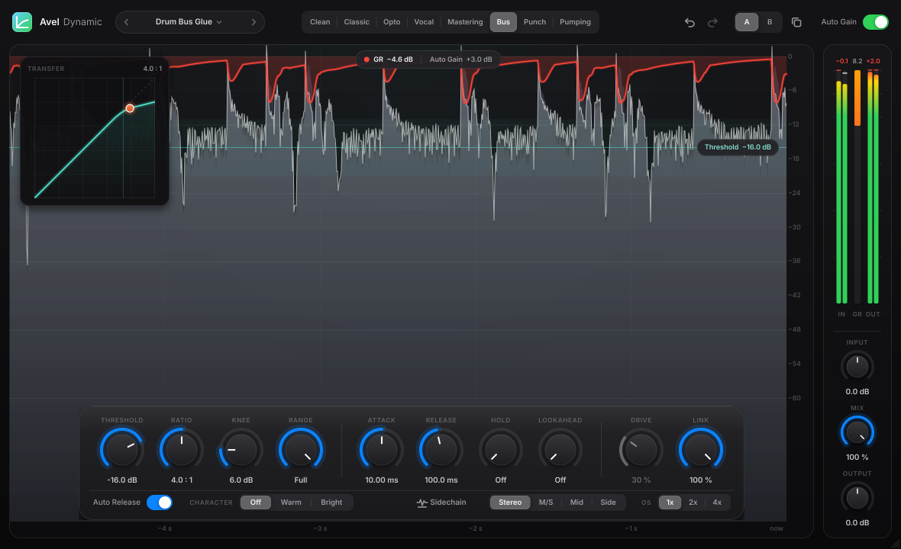

# Avel Dynamic — компрессор линейки Avel

Avel Dynamic — компрессор в духе FabFilter Pro-C 3. В нём 8 стилей, бегущая история уровня, на которой видно подавление, передаточная кривая с живой точкой детектора, сайдчейн-фильтры и внешний сайдчейн, Mid/Side, lookahead, hold, оверсэмплинг до 4x, насыщение, Auto Gain, A/B и пресеты. Оформление общее для всех плагинов Avel: Avel EQ, Avel Ember, Avel Dynamic.



Форматы: VST3 (Windows и macOS) и AU (macOS). Задержка нулевая, пока не включены Lookahead или оверсэмплинг.

## Установка

### macOS: `AvelDynamic-1.0.0-macOS.pkg`
1. Дважды кликните по файлу → Продолжить → Установить. Мак спросит пароль.
   Установщик кладёт VST3 и Audio Unit в `/Library/Audio/Plug-Ins` для всех пользователей.
2. Если macOS пишет, что не может проверить разработчика:
   - macOS 15 и новее: откройте файл, закройте предупреждение, затем **Системные настройки → Конфиденциальность и безопасность** → «Всё равно открыть»;
   - macOS 14 и старше: правый клик по файлу → **Открыть** → Открыть.
3. Перезапустите DAW. Плагин находится в категории **Dynamics**.

### Windows: `AvelDynamic-1.0.0-Windows-Setup.exe`
1. Запустите файл → Далее → Установить. Плагин ставится в `C:\Program Files\Common Files\VST3`.
2. Если появится окно «Windows защитила ваш компьютер»: **Подробнее → Выполнить в любом случае**.
3. Перезапустите DAW и пересканируйте плагины.

## Окно плагина

**Верхняя панель:** пресеты (стрелки листают заводские, клик по имени открывает список), отмена и повтор, **стиль** по центру, A/B с кнопкой копирования, Auto Gain.

**Дисплей:**
- серо-синяя заливка показывает вход, белая — выход;
- красная линия сверху показывает подавление (gain reduction) в дБ по той же шкале справа;
- бирюзовая линия — порог. Её можно тянуть мышью; двойной клик сбрасывает, колесо двигает шагами. Подсвеченная полоса вокруг порога — ширина колена;
- окно **Transfer** слева показывает передаточную кривую. Точка на ней — текущий уровень детектора; когда компрессор работает, точка становится красной. Тяните по окну вверх и вниз, чтобы менять порог, колесо меняет Ratio.

**Карточка внизу:**

| Ручка | Что делает |
|---|---|
| Threshold | Порог, выше которого начинается сжатие (−60…0 дБ). |
| Ratio | Степень сжатия от 1:1 до ∞:1. |
| Knee | Мягкость перехода у порога (0…36 дБ). |
| Range | Максимальная глубина подавления. Full — без ограничения. |
| Attack / Release | Скорость реакции (0,005…250 мс) и восстановления (5 мс…2,5 с). |
| Hold | Держит подавление перед началом release. |
| Lookahead | Компрессор «видит» пик заранее (до 20 мс, добавляет задержку). |
| Drive | Сила насыщения (активна при Character Warm или Bright). |
| Link | Связка каналов: 100 % — общая обработка, 0 % — независимая. |

Нижняя строка карточки:
- **Auto Release** — релиз зависит от материала: после коротких пиков он быстрый, на длинном сжатии медленный.
- **Character** — насыщение после компрессора. Warm даёт чётные гармоники с мягким верхом, Bright — нечётные гармоники в верхней области.
- **Sidechain** открывает панель с фильтрами детектора (High-pass, Low-pass), переключателем **External** и кнопкой **Listen**.
- **Stereo / M/S / Mid / Side** — что сжимать: стерео, середину и стороны раздельно, только середину или только стороны.
- **OS** — оверсэмплинг 1x / 2x / 4x. Он меньше всего нужен на медленных настройках и больше всего полезен на быстрой атаке и с Drive.

**Правая колонка:** пиковые индикаторы IN / GR / OUT (клик сбрасывает цифры), ручки Input, Mix и Output. Mix ниже 100 % — это параллельная компрессия без фазовых проблем, потому что сухой сигнал задерживается ровно на латентность.

Под колонкой отображается текущая задержка, если она есть.

### Стили

| Стиль | Характер |
|---|---|
| Clean | Прозрачный пиковый компрессор, делает ровно то, что выставлено. |
| Classic | Схема с обратной связью и мягким коленом, как у классических VCA. |
| Opto | Медленный плавный «оптический» выравниватель, релиз зависит от материала. |
| Vocal | Широкое автоматическое колено и RMS-детектор, ровно ведёт голос. |
| Mastering | Мягкий RMS, скруглённая атака, адаптивный релиз. |
| Bus | «Клей» для групп и мастер-шины. |
| Punch | Скруглённая атака пропускает транзиенты, барабаны щёлкают. |
| Pumping | Восстановление в линейной шкале, слышимая «накачка». |

### Auto Gain
Компенсирует громкость, потерянную на сжатии: сигнал на уровне −12 dBFS после компрессора остаётся той же громкости. Так удобнее сравнивать звук, а не громкость. В режимах Mid и Side компенсация применяется только к той части, которая сжимается. Текущее значение видно в пилюле над дисплеем.

### Внешний сайдчейн
Плагин видит второй вход как сайдчейн. В REAPER: у трека с Avel Dynamic нажмите кнопку **I/O** (route) и добавьте посыл с трека-ключа (например, бочки) в каналы 3/4. В Ableton, Logic, Cubase и Studio One выберите источник в меню Sidechain плагина. Затем включите **External** в панели Sidechain. Если ключ не подключён, панель об этом скажет.

### Пресеты
22 заводских пресета в группах General, Vocals, Drums, Instruments и Mix Bus. Свои пресеты сохраняются через **Save Preset As…** в папку
`Документы/Avel/Avel Dynamic/Presets` (файлы `.avelpreset`) и появляются в том же списке. Загрузку пресета можно отменить кнопкой Undo.

### A/B
A и B — два независимых набора настроек. Кнопка копирования переносит текущий набор в другой слот. Оба слота сохраняются в проекте.

## Сборка из исходников

**macOS одной командой.** Нужны только Xcode Command Line Tools; CMake скрипт скачает сам, если его нет:

```
cd путь/к/AvelDynamic
bash build_mac.sh
```

Скрипт соберёт VST3 и AU и сразу установит их в `~/Library/Audio/Plug-Ins`. Установщик `.pkg` делает `bash make_installer_mac.sh`.

**Вручную.** Нужны CMake 3.22+ и компилятор: Xcode на macOS или Visual Studio 2022 на Windows. JUCE скачается сам.

```
cmake -S . -B build -DCMAKE_BUILD_TYPE=Release
cmake --build build --config Release --target AvelDynamic_VST3
```

На GitHub сборка под обе системы идёт автоматически (`.github/workflows/build.yml`). После каждого push в main собираются и проверяются установщики для macOS и Windows (auval, pluginval, тестовая установка), а затем публикуются на странице **Releases**.

### Тесты
```
cmake -S . -B build -DAVEL_BUILD_TESTS=ON
cmake --build build --target AvelDynamicTest
./build/AvelDynamicTest_artefacts/Release/AvelDynamicTest shots
```
Тестовая программа проверяет:
- прозрачность при 1:1;
- статическую кривую каждого стиля;
- совпадение латентности для сухого и обработанного сигнала (lookahead + 4x);
- Auto Gain;
- устойчивость на экстремальных настройках;
- внешний сайдчейн, M/S, моно;
- сохранение состояния и A/B;
- пресеты и Undo.

Затем она сохраняет скриншоты окна в папку `shots`.

## Дизайн-система Avel
Файл `Source/UI/Theme.h` общий для всех продуктов Avel: цвета, шрифт Inter, стеклянные карточки, `Dial`, `Segmented`, `Switch`, `IconButton`, меню и подсказки. Собственные цвета Avel Dynamic (логотип и подсветка дисплея: циан → зелёный) лежат в `Source/UI/Display.h`, в `namespace product`. Улучшения в `Theme.h` переносите во все продукты.

## Лицензии
Плагин построен на фреймворке JUCE 8. Для личного некоммерческого использования ничего платить не нужно. Если будете распространять плагин, исходники должны оставаться открытыми (AGPLv3) или нужна лицензия JUCE.
Шрифт Inter распространяется по SIL Open Font License 1.1 (`Resources/Fonts/Inter-LICENSE.txt`).
